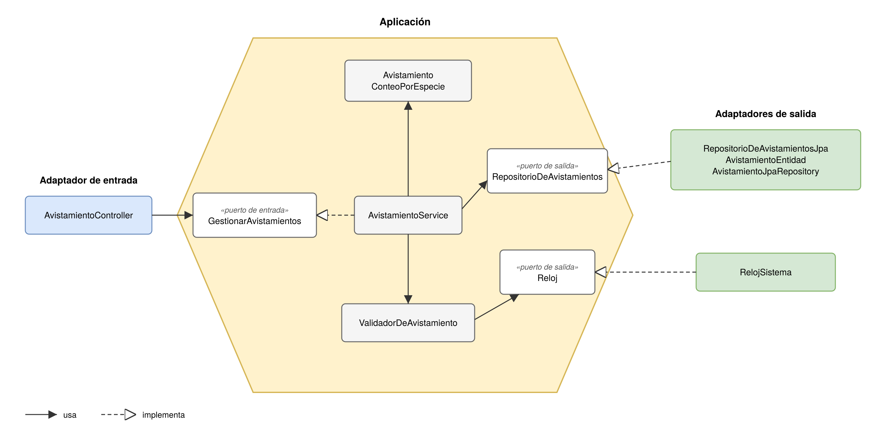
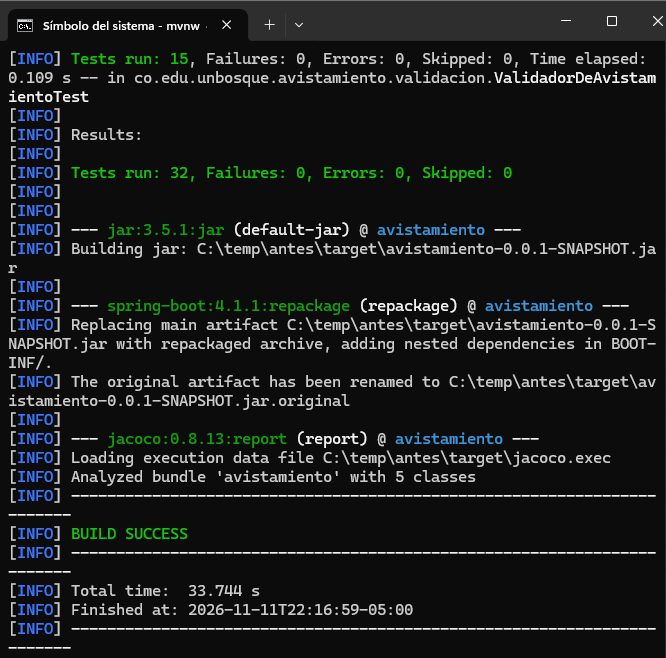
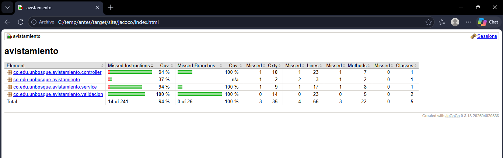
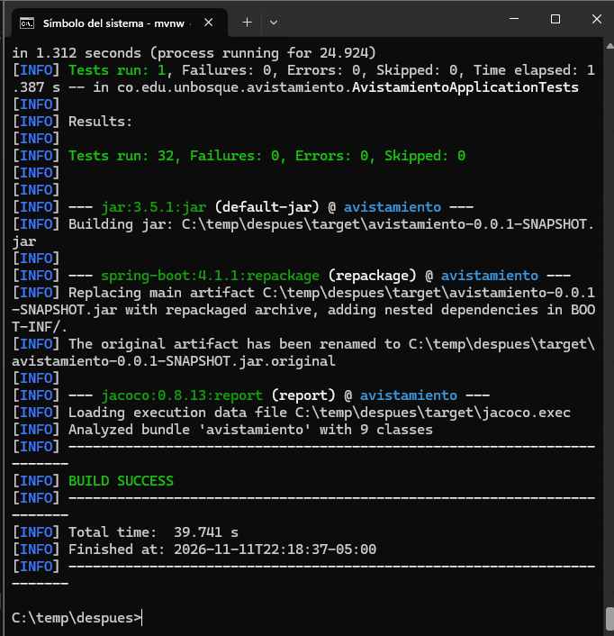
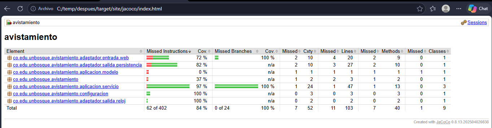
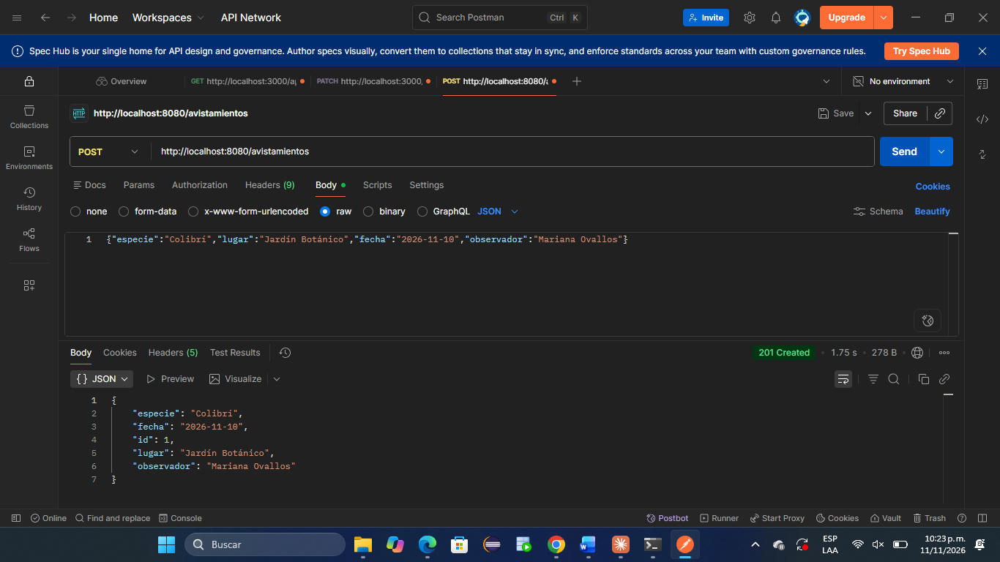
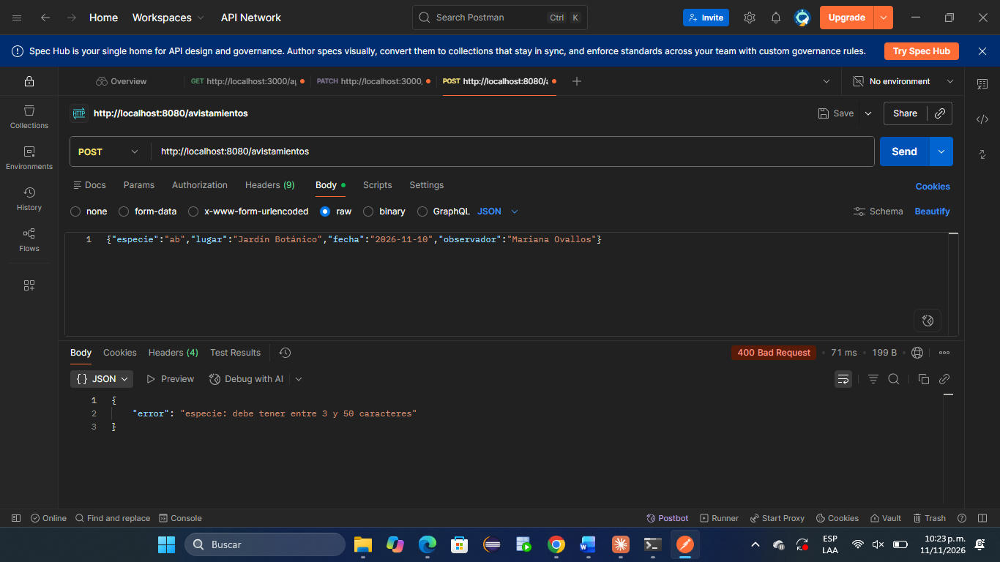

# Taller: Clean Architecture y arquitectura hexagonal

Mariana Ovallos Romero

Ingeniería de Software 2

Jonathan Briceño

Universidad El Bosque

Bogotá D.C.

Noviembre

2026

## Primera Parte

**Preguntas:**

**1.** Cockburn (2005) parte de un problema que ve en las aplicaciones de su época. ¿Cuál es ese problema? ¿Qué es un puerto y qué es un adaptador en su propuesta? ¿Por qué dice que hay una simetría entre el lado del usuario y el lado de la base de datos?

**Rta:** El problema que ve Cockburn es que la lógica de negocio se mezcla con la interfaz de usuario y con la base de datos, así el sistema no se puede probar con pruebas automáticas ni usar sin la pantalla, y si la base de datos se cae, los programadores no pueden trabajar (Cockburn, 2005).

Un puerto es una conversación con un propósito entre la aplicación y algo externo, y se define como una API. Un adaptador es el código que conecta una tecnología concreta a ese puerto, por ejemplo una interfaz gráfica, una prueba automática, una base de datos SQL o una base de datos simulada en memoria (Cockburn, 2005).

Hay simetría porque los dos lados tienen la misma causa del problema. Para Cockburn lo importante no es izquierda o derecha, sino adentro y afuera, el usuario y la base de datos están afuera, y los dos se conectan a la aplicación por un puerto con un adaptador (Cockburn, 2005).

**2.** Martin (2012) dibuja Clean Architecture como círculos concéntricos. ¿Qué va en cada círculo? Martin enuncia una sola regla para todo el diagrama, la regla de dependencia (The Dependency Rule): ¿qué dice esa regla sobre la dirección en que puede apuntar el código, y qué prohíbe?

**Rta:** En el primer círculo, el del centro, están las entidades, que son las reglas de negocio más generales y las que menos cambian (Martin, 2012). En el segundo círculo están los casos de uso, que son las reglas propias de esta aplicación, lo que el sistema hace paso a paso (Martin, 2012). En el tercer círculo están los adaptadores de interfaz, que convierten los datos entre el formato que usan los casos de uso y el que usa algo externo. Aquí van los controladores y el código SQL (Martin, 2012). El último círculo es el de frameworks y drivers: la web, la base de datos y las herramientas. Aquí casi no se escribe código, solo lo necesario para conectar con el círculo de adentro (Martin, 2012).

La regla de dependencia dice que el código solo puede depender hacia adentro, nunca al revés (Martin, 2012). Un círculo de adentro no puede saber nada de lo que está afuera. No puede nombrar clases, funciones ni variables de un círculo externo, y tampoco puede usar sus formatos de datos (Martin, 2012).

**3.** Según la regla anterior, el caso de uso no puede depender de la base de datos. Pero el caso de uso necesita guardar datos. ¿Cómo resuelve Clean Architecture esa contradicción? Expliquen el mecanismo con un ejemplo (Martin lo trata en el mismo artículo, y también sirve el principio de inversión de dependencias que vieron en SOLID).

**Rta:** Clean Architecture resuelve esto con el principio de inversión de dependencias (Martin, 2012). Adentro, junto al caso de uso, se crea una interfaz que dice lo que el caso de uso necesita, por ejemplo guardar un avistamiento, y afuera una clase implementa esa interfaz y es la que usa la base de datos. El caso de uso solo conoce la interfaz y no sabe qué hay detrás (Martin, 2012), así, cuando el programa corre, el caso de uso llama hacia afuera, pero en el código la dependencia apunta hacia adentro, porque la clase de afuera es la que conoce la interfaz de adentro (Martin, 2012).

Por ejemplo, en mi API el servicio AvistamientoService usa la interfaz RepositorioDeAvistamientos con el método guardar(). La clase RepositorioDeAvistamientosJpa implementa esa interfaz y guarda en la base de datos. Si cambio la base de datos, solo cambio esa clase y el servicio queda igual.

**4.** Comparen la arquitectura hexagonal (Cockburn, 2005), la de cebolla (Palermo, 2008) y Clean Architecture (Martin, 2012). ¿Qué tienen en común las tres? ¿Qué cambia de una a otra: el vocabulario, el número de capas, ¿algo más?

**Rta:** Las tres ponen las reglas de negocio en el centro y dejan la base de datos, la interfaz y el framework afuera, como detalles que se pueden cambiar, las tres usan interfaces para que lo de afuera dependa de lo de adentro (Cockburn, 2005; Palermo, 2008; Martin, 2012). Lo que cambia es la forma de organizar el interior como en la hexagonal que solo separa lo de adentro y lo de afuera, y habla de puertos y adaptadores (Cockburn, 2005), la de cebolla organiza capas alrededor del modelo de dominio y deja la base de datos en el borde (Palermo, 2008) y Clean Architecture junta las dos en cuatro círculos con nombre fijo y separa las entidades de los casos de uso (Martin, 2012).

**5.** Su API es pequeña: unos pocos endpoints y una regla de validación. ¿Se justifica aplicarle Clean Architecture? Argumenten con al menos un costo (trade-off) y un beneficio concretos, y tomen una posición. No hay una única respuesta correcta: se califica el argumento.  
**Rta:** Pienso que no se justifica aplicarla completa en esta API, por que la API solo tiene unos pocos endpoints y una regla de validación, como costo si la aplicamos obliga a crear más clases, interfaces y conversiones entre la entidad del negocio y la de JPA, y eso sería más código de estructura que de lógica y Palermo dice que la arquitectura de cebolla no es apropiada para sitios pequeños, sino para aplicaciones grandes y de larga vida (Palermo, 2008) y como Martin presenta Clean Architecture como una unión de esa y otras arquitecturas (Martin, 2012), pienso que el mismo límite aplica. Como beneficio, la validación y los casos de uso quedarían separados de Spring y de la base de datos, y se podrían probar sin levantar ninguno de los dos (Martin, 2012).

## Segunda parte

### Elección de arquitectura

**Rta:** Elegí la arquitectura hexagonal (Cockburn, 2005) por que la API es pequeña, y esta arquitectura solo pide separar la aplicación de lo externo, sin obligar a crear varias capas en el interior, con eso puedo separar las reglas de Spring y de la base de datos sin agregar tantas clases como pediría Clean Architecture y la API ya tenía una parte organizada así que es el validador que usa la interfaz Reloj, que funciona como puerto, y RelojSistema y RelojFijo funcionan como adaptadores.

### Repositorio

https://github.com/marianaovallos0-cmd/avistamientos-api (rama main)

### Estructura de carpetas

```
co.edu.unbosque.avistamiento
├── aplicacion
│ ├── modelo Avistamiento, ConteoPorEspecie
│ ├── puerto
│ │ ├── entrada GestionarAvistamientos
│ │ └── salida RepositorioDeAvistamientos, Reloj
│ └── servicio AvistamientoService, ValidadorDeAvistamiento,
│ AvistamientoInvalidoException
├── adaptador
│ ├── entrada/web AvistamientoController
│ └── salida
│ ├── persistencia AvistamientoEntidad, AvistamientoJpaRepository,
│ │ RepositorioDeAvistamientosJpa
│ └── reloj RelojSistema
└── configuracion ConfiguracionAplicacion
```

### Diagrama de dependencias



### Evidencia antes del refactor





### Evidencia después del refactor





### La API responde igual





### Qué fue lo más difícil de separar

Lo más difícil fue separar el modelo Avistamiento de JPA. Antes la misma clase era la entidad de la base de datos y el objeto del negocio. Para que el centro no dependiera de JPA tuve que crear una entidad aparte, AvistamientoEntidad, y pasar los datos de una a otra en el adaptador. También fue difícil el resumen por especie, porque la consulta de JPA devolvía filas como Object\[\], que es un formato de afuera, y lo cambié por ConteoPorEspecie.

### Referencias

Cockburn, A. (2005). Hexagonal architecture. https://alistair.cockburn.us/hexagonal-architecture/

Martin, R. C. (2012). The Clean Architecture. https://blog.cleancoder.com/uncle-bob/2012/08/13/the-clean-architecture.html

Palermo, J. (2008). The Onion Architecture: part 1. https://jeffreypalermo.com/2008/07/the-onion-architecture-part-1/
